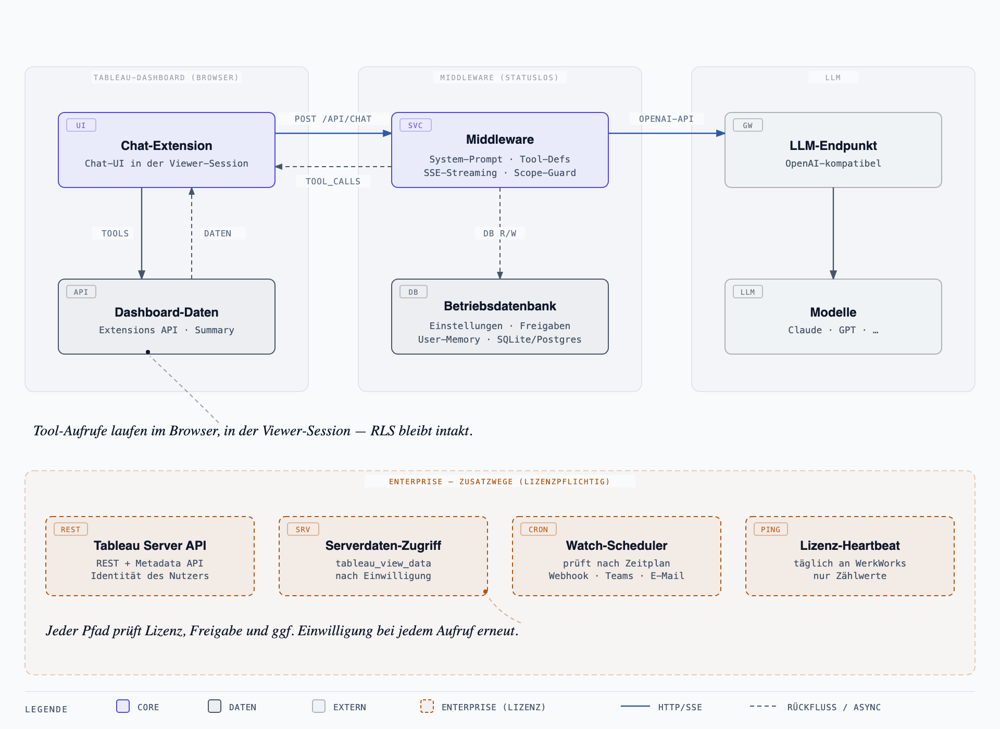

# Architektur

Überblick für Entwickler und Agenten: welche Teile es gibt, wie eine Frage durch das System läuft, wo die Grenze zwischen Core und Enterprise verläuft und welche Sicherheitsgrenzen der Code einhält. Für den Betrieb siehe [admin-deployment.md](admin-deployment.md), für die tägliche Arbeit [development.md](development.md).

Weitere Diagramme: [Datenzugriff](diagrams/datenzugriff.png) und [Lizenzzustände](diagrams/lizenz-zustaende.png). Quelle ist jeweils die `.html`-Datei daneben.

## 1. Ziele und Grundsätze

- **Daten bleiben in der Tableau-Sitzung des Betrachters.** Das LLM liest Dashboard-Daten nur über Tools, die die Extension im Browser über die Tableau Extensions API ausführt. Zeilenebenen-Sicherheit und Benutzerfilter gelten unverändert.
- **Die Middleware ist zustandslos, was Gespräche angeht.** Sie fügt System-Prompt und Tool-Definitionen ein, streamt die Antwort des LLM per SSE und hat keine eigene Tableau-Identität. Der Chatverlauf lebt im Browser.
- **Änderungen am Dashboard nur auf Klick.** Das LLM schlägt Aktionen vor, die Person führt sie aus.
- **Core läuft allein.** Alles außerhalb von `ee/` baut und läuft ohne Enterprise-Code; Enterprise-Funktionen hängen an einer Lizenz, die serverseitig geprüft wird.

## 2. Workspaces

| Workspace | Paket | Rolle |
|---|---|---|
| `packages/shared` | `@openvizpilot/shared` | Vertrag zwischen Server und Extension: zod-Schemas, SSE-Protokoll, Tool-Definitionen, i18n, Slash-Befehle, Playbooks, `.trex`-Vorlage. Kein Build-Artefakt, wird als TypeScript-Quelle importiert. |
| `packages/server` | `@openvizpilot/server` | Middleware auf Hono. Wird mit tsup samt Abhängigkeiten zu `dist/index.js` gebündelt und liefert in Produktion auch die Extension aus. |
| `packages/extension` | `@openvizpilot/extension` | Dashboard-Extension auf Vite + Preact: Chat-UI, Agent-Loop, Tool-Executoren, Kontext-Snapshot. |
| `ee/` | `@openvizpilot/ee` | Enterprise Edition. Im öffentlichen Repo ein Stub mit gleicher Paket-API (siehe Abschnitt 5). |

Abhängigkeiten laufen nur in eine Richtung: `shared` kennt niemanden, `server` und `extension` importieren `shared` und die jeweilige Seite von `ee` (`@openvizpilot/ee/server` bzw. `@openvizpilot/ee/extension`), `ee` importiert `shared`.

## 3. Der Weg einer Frage

1. **Kontext.** Die Extension baut beim Senden einen Kontext-Snapshot des geöffneten Dashboards (`packages/extension/src/tableau/context-snapshot.ts`): Arbeitsblätter, Filter, Parameter, Markierungen, ausgeblendete Bereiche.
2. **Anfrage.** Der Agent-Loop (`packages/extension/src/chat/agent-loop.ts`) schickt Verlauf und Snapshot an `POST /api/chat`. Die Historie wird auf ein Zeichenbudget gekürzt.
3. **Middleware.** `packages/server/src/routes/chat.ts` prüft Anmeldung und Freigabe, lässt die Frage vom Scope-Guard klassifizieren (`packages/server/src/llm/scope-guard.ts`; themenfremde Fragen bekommen eine feste Absage, ohne dass das Hauptmodell gefragt wird), baut den System-Prompt (`packages/server/src/system-prompt.ts`) samt lizenzabhängiger Abschnitte und ruft das LLM über das OpenAI-SDK auf (`packages/server/src/llm/client.ts`).
4. **Stream.** Die Antwort kommt als SSE zurück (`packages/shared/src/sse-protocol.ts`): `delta` für Text, `tool_calls` einmal pro Antwort und serverseitig vollständig zusammengesetzt und validiert, `done` mit Abschlussgrund und Token-Verbrauch, `error` mit klassifizierter Meldung, `ping` als Heartbeat. Rohe Fehlertexte des LLM-Anbieters gehen nie an den Browser.
5. **Tools.** Fordert das LLM Tools an, führt die Extension sie lokal aus (`packages/extension/src/tools/registry.ts`, Executoren in `tools/executors/`) und schickt die Ergebnisse in der nächsten Runde mit. Executoren werfen nie; Fehler gehen als Text an das LLM zurück. Das Rundenbudget hängt vom Modus ab (`TOOL_ROUNDS_BY_MODE`: Fragen 5, Untersuchen 12, umgebungsweite Untersuchung 24).
6. **Antwort.** Die Extension zeigt Text, Analyse-Spur und Quellen. Ein Vorschlagsblock am Ende der Antwort wird zu Chips für Anschlussfragen und, mit Lizenz `actions`, Dashboard-Aktionen (`packages/extension/src/tableau/actions.ts`).

Die Dashboard-Tools sind in `packages/shared/src/tools.ts` definiert (`toolArgSchemas`, `toolDefinitions`): `list_worksheets`, `get_worksheet_fields`, `get_worksheet_summary_data`, `get_filters`, `get_parameters`, `get_selected_marks`, `get_datasource_info`, `aggregate_summary_data`, `breakdown_by`, `compare_periods`, dazu `lookup_metric` für den Kennzahlenkatalog, das als einziges die Middleware fragt.

## 4. Die Middleware

`packages/server/src/index.ts` liest die Konfiguration (`env.ts`, zod-Schema über `OVP_*`) und startet die App aus `app.ts`. Dort entsteht der Ablauf in dieser Reihenfolge:

- **Speicher.** `memory/store.ts` wählt das Backend: Postgres über `OVP_DATABASE_URL` (Produktion, im Helm-Chart optional als CloudNativePG-Cluster) oder SQLite über das eingebaute `node:sqlite` mit `OVP_DATABASE_PATH` (lokale Entwicklung). Gespeichert werden nur Zustände der Anwendung: Konten und Sitzungen, Admin-Einstellungen, Freigaben, Modell-Katalog, Slash-Befehle und Playbooks, anonyme Zähler. Enterprise-Module legen eigene Tabellen auf derselben Verbindung an.
- **Anmeldung.** `auth-state.ts` bestimmt den Modus: `none`, `token` (statisches `OVP_API_AUTH_TOKEN`), `local` (Passwort-Konten) oder `oidc` (SSO, Enterprise). Die Middleware für `/api/*` setzt ihn durch; `/api/admin/`, `/api/auth/` und `/api/tableau-mcp` prüfen selbst.
- **Freigaben.** `user-access.ts` (`requireUserAccess`) verlangt für KI-Funktionen die Freigabe der Person durch einen Admin (siehe [user-approvals.md](user-approvals.md)).
- **Routen.** `routes/` enthält `chat`, `models`, `desktop`, `commands`, `metrics`, `dashboards`, `stats`, `admin`, `auth` und `health`. Enterprise-Routen kommen aus `@openvizpilot/ee/server`: Auth-Callback, Memory, MCP, Tableau Server, Tableau-MCP, Watch.
- **Admin-UI.** `GET /admin` liefert eine eigenständige Seite aus `admin-page.ts`: ein Template-String mit Vanilla-JS, ohne Build-Schritt.
- **Statik.** Mit `OVP_SERVE_STATIC_DIR` liefert der Server die gebaute Extension selbst aus (gleiche Origin, kein CORS). So läuft es im Docker-Image.
- **Logging.** `logger.ts` schreibt nur Metadaten, nie Inhalte.

## 5. Core und Enterprise

Das private Repo `bl0rb/OpenVizPilotEnterprise` enthält das echte `ee/`; das öffentliche `bl0rb/OpenVizPilot` entsteht daraus per Core-Export, bei dem `ee-stub/` an die Stelle von `ee/` tritt. Der Stub exportiert dieselben Namen wie das echte `ee/`, soweit der Kern sie importiert, und verhält sich wie eine Installation ohne Lizenz: Lizenzprüfungen ergeben „keine Lizenz“, lizenzpflichtige Routen antworten mit 402, Speicher liefern leere Ergebnisse. `EE_STUB` unterscheidet beide zur Laufzeit.

Lizenzpflichtige Funktionen und ihre Feature-Schlüssel:

| Feature | Funktion |
|---|---|
| `sso` | Single Sign-On über OIDC (Entra ID, Keycloak, generisch) |
| `memory`, `savedQueries` | User-Memory und eigene Standardfragen je Dashboard |
| `actions` | Dashboard-Aktionen aus dem Chat |
| `mcp` | MCP-Quellen und Websuche |
| `tableauServer` | Tableau-Server-Anbindung: Content-Suche, Metadata-API, Tableau-MCP, Desktop-Endpunkt |
| `serverData` | Serverseitiges Lesen fremder Views (umgebungsweite Untersuchung, Watch) |
| `watch` | Dashboards beobachten und melden |

Die Lizenz wird beim Start und vor jeder lizenzpflichtigen Ausführung serverseitig geprüft; ohne `actions` kennt das Modell die Aktionssyntax gar nicht. Lizenzformat, Aktivierung und Lease: [enterprise.md](enterprise.md).

## 6. Weitere Clients (Enterprise)

- **Desktop-App** ([bl0rb/OpenVizPilotDesktop](https://github.com/bl0rb/OpenVizPilotDesktop)) spricht mit `/api/desktop`. Ohne geöffnetes Dashboard läuft der Agent-Loop serverseitig, nur mit den Tableau-Server-Tools und dem Kennzahlenkatalog. Siehe [desktop.md](desktop.md).
- **Tableau-MCP** unter `/api/tableau-mcp` stellt dieselben Tools externen Agenten bereit. Es arbeitet als OAuth-Resource-Server; die Discovery-Daten liegen unter `/.well-known/oauth-protected-resource`. Siehe [tableau-mcp.md](tableau-mcp.md).

Beide handeln ausschließlich unter der persönlichen Identität der angemeldeten Person. Die Daten-Tools gibt es nur mit Lizenz `serverData`, der Freigabe „Serverdaten“ und der Einwilligung der Person.

## 7. Sicherheitsgrenzen

- Keine Tableau-Identität in der Middleware: kein Service-Account, kein PAT, kein Handeln im Namen Dritter.
- Serverseitiger Datenzugriff nur mit Lizenz, Freigabe je Person und Einwilligung; mit Audit und Budgets ([tableau-server.md](tableau-server.md#limits-und-budgets)).
- Upstream-Fehler werden klassifiziert statt durchgereicht; der LLM-Key verlässt die Middleware nie.
- Im Admin-UI gespeicherte Secrets sind mit AES-256-GCM verschlüsselt, Schlüssel aus `OVP_SECRET_KEY`.
- Nutzungszahlen werden nur mit nicht umkehrbaren Pseudonymen gezählt (`usage-pseudonym.ts`).
- Externe Datenübertragungen über MCP brauchen eine Bestätigung der Person ([mcp.md](mcp.md)).
